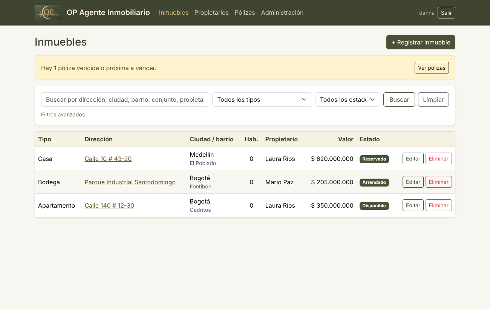
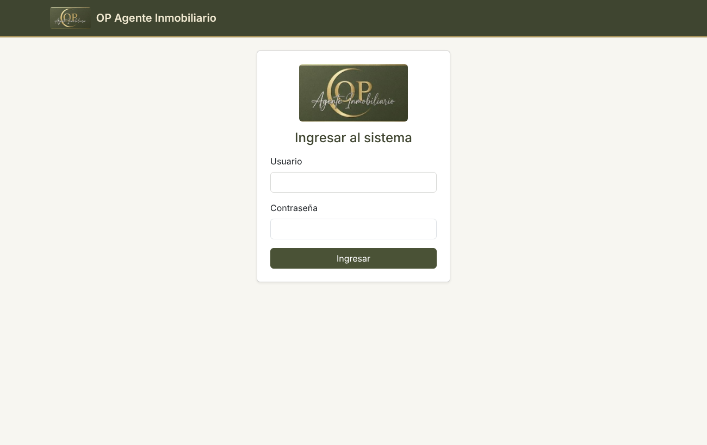
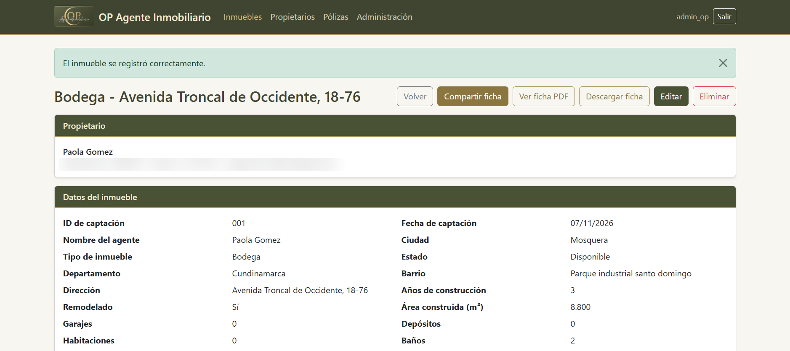
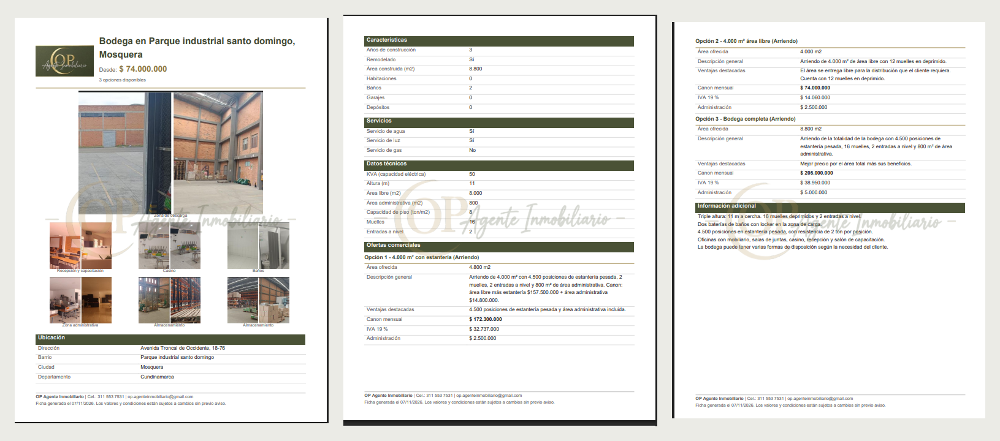
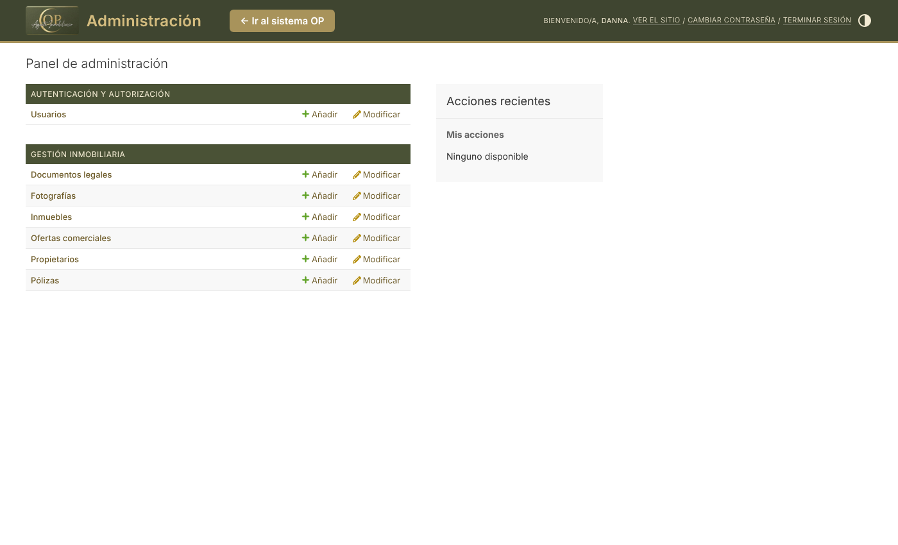

# Sistema de Gestión Inmobiliaria — OP Agente Inmobiliario

Sistema web para centralizar la información de los inmuebles de **OP Agente Inmobiliario**: características, propietarios, ofertas comerciales, fotografías, documentos legales y pólizas, con búsqueda avanzada y generación de fichas en PDF para compartir con los clientes.

Proyecto de práctica profesional de **Danna Valentina Betancourt Pico**, Ingeniería de Software, Facultad de Ingeniería, Corporación Universitaria Iberoamericana (Bogotá, 2026).



## Contenido

- [Problema que resuelve](#problema-que-resuelve)
- [Funcionalidades](#funcionalidades)
- [Tecnologías](#tecnologías)
- [Arquitectura y modelo de datos](#arquitectura-y-modelo-de-datos)
- [Estructura del proyecto](#estructura-del-proyecto)
- [Instalación y ejecución](#instalación-y-ejecución)
- [Pruebas](#pruebas)
- [Publicación en producción](#publicación-en-producción)
- [Capturas](#capturas)
- [Estado del proyecto](#estado-del-proyecto)

## Problema que resuelve

La empresa administraba la información de sus inmuebles en hojas de cálculo, carpetas físicas y conversaciones de WhatsApp, sin un sistema que la integrara. Esto generaba demoras para ubicar un inmueble, riesgo de enviar fotos o datos desactualizados a los clientes y falta de claridad sobre el propietario y el estado de cada propiedad. El sistema reúne todo en un solo lugar y genera una ficha profesional de cada inmueble.

## Funcionalidades

| Módulo | Descripción |
|---|---|
| Inmuebles | Ficha única para todos los tipos (casa, apartamento, bodega, local, lote, otro), organizada por secciones. Las secciones de zonas comunes y de datos de bodega solo aparecen para los tipos que aplican. |
| Ofertas comerciales | Cada inmueble tiene una o varias ofertas (venta o arriendo), con área, precio o canon, IVA del 19 % calculado y administración. |
| Propietarios | Registro con identificación única; un propietario puede tener varios inmuebles. |
| Fotografías | Carga múltiple con etiqueta por área. Las fotos se reducen automáticamente (máximo 1.920 px) para ahorrar espacio. |
| Documentos legales | Escritura, certificado de tradición, impuesto predial, planos, contrato de consignación y otros, en PDF, Word, Excel o imagen. |
| Pólizas | Registro con documento adjunto y alertas: vigente, por vencer (30 días o menos) o vencida. |
| Búsqueda y filtros | Texto, tipo, estado, modalidad, ciudad, barrio, rango de precio, habitaciones mínimas y ordenamiento, combinables entre sí. |
| Ficha en PDF | Ficha para el cliente con logo, marca de agua, fotografías, características, ofertas y contacto de la empresa. Excluye los datos internos (propietario, matrículas, margen, impuesto predial). |
| Compartir | Botón que abre el menú de compartir del dispositivo (WhatsApp, correo, etc.) con la ficha adjunta. |
| Seguridad | Acceso solo con usuario y contraseña. Fotografías y documentos se entregan únicamente con sesión iniciada. |
| Administración | Panel de Django personalizado con la imagen de la empresa para gestionar usuarios y registros. |

## Tecnologías

| Componente | Versión | Uso |
|---|---|---|
| Python | 3.13 | Lenguaje |
| Django | 6.1 | Framework web: modelos, vistas, plantillas, autenticación, administración y pruebas |
| SQLite | incluida | Base de datos |
| Pillow | 12 o superior | Validación y reducción de imágenes |
| xhtml2pdf | 0.2.27 | Generación de la ficha en PDF (incluye pypdf y reportlab, usados para la marca de agua) |
| Bootstrap | 5.3.3 (CDN) | Diseño de la interfaz web |

## Arquitectura y modelo de datos

Arquitectura en capas con el patrón **Modelo-Vista-Plantilla (MVT)** de Django:

```
Navegador ──► Plantillas (Django Templates + Bootstrap)
                 │
                 ▼
             Vistas (lógica de negocio: validación, filtros, PDF, alertas)
                 │
                 ▼
             ORM de Django (models.py) ──► Base de datos SQLite
                 │
                 └──► Carpeta media/ (fotografías y documentos)
```

Entidades:

```
Propietario 1 ──── N Inmueble 1 ──── N OfertaComercial
                            ├── N Fotografia
                            ├── N Documento
                            └── N Poliza
```

## Estructura del proyecto

```
gestion-inmobiliaria-op/
├── manage.py
├── requirements.txt
├── gestion_inmobiliaria/        # Configuración (settings.py, urls.py)
├── templates/admin/             # Personalización del panel de administración
├── docs/                        # Capturas y ficha de ejemplo para este README
└── inmuebles/                   # Aplicación principal
    ├── models.py                # Entidades
    ├── views.py                 # Lógica de cada pantalla
    ├── forms.py                 # Formularios y validaciones
    ├── ficha.py                 # Generación de la ficha en PDF
    ├── formato.py               # Formato en pesos, fechas y etiquetas en español
    ├── admin.py                 # Panel de administración
    ├── tests.py                 # Pruebas automáticas
    ├── migrations/              # Cambios de la base de datos
    ├── locale/                  # Traducciones faltantes de Django
    ├── static/inmuebles/        # Logo, marca de agua y colores de la marca
    └── templates/               # Pantallas del sistema
```

## Instalación y ejecución

Requisitos: Python 3.13 y Git.

```bash
# 1. Descargar el proyecto
git clone https://github.com/Danna0711/gestion-inmobiliaria-op.git
cd gestion-inmobiliaria-op

# 2. Crear y activar el entorno virtual
python -m venv venv
venv\Scripts\activate          # Windows
# source venv/bin/activate     # Linux o macOS

# 3. Instalar las librerías
pip install -r requirements.txt

# 4. Crear la base de datos
python manage.py migrate

# 5. Crear el usuario administrador
python manage.py createsuperuser

# 6. Iniciar el servidor
python manage.py runserver
```

Luego abrir **http://127.0.0.1:8000** para el sistema y **http://127.0.0.1:8000/admin/** para el panel de administración. Los usuarios de los asesores se crean desde el panel, en «Usuarios».

> En Windows, si PowerShell no permite activar el entorno virtual, ejecutar una vez `Set-ExecutionPolicy -Scope CurrentUser RemoteSigned`.

## Pruebas

El sistema cuenta con **135 pruebas automáticas** que cubren los 17 requerimientos funcionales, la seguridad de acceso y los 5 casos de uso. Usan una base de datos y una carpeta de archivos temporales, por lo que no modifican los datos reales.

```bash
python manage.py test inmuebles          # resumen
python manage.py test inmuebles -v 2     # detalle de cada prueba
```

## Publicación en producción

En desarrollo no se necesita configuración adicional. En el servidor se activa el modo de producción con estas variables de entorno (nunca se suben al repositorio):

| Variable | Valor |
|---|---|
| `DJANGO_PRODUCCION` | `1` |
| `DJANGO_SECRET_KEY` | Clave secreta larga y aleatoria |
| `DJANGO_ALLOWED_HOSTS` | Dominio del sitio, por ejemplo `opagente.pythonanywhere.com` |

Con el modo de producción activo: `DEBUG` desactivado, solo HTTPS, cookies seguras y sesión de 12 horas. Después de instalar se ejecutan `python manage.py migrate` y `python manage.py collectstatic`, y la carpeta `staticfiles/` se publica como `/static/`. El alojamiento previsto es PythonAnywhere.

## Capturas

| Ingreso | Detalle del inmueble |
|---|---|
|  |  |

   Ficha en PDF ([ver ejemplo](docs/ficha_ejemplo.pdf)):

    |

Panel de administración:



*Las capturas usan datos de prueba.*

## Estado del proyecto

| Fase | Actividades | Estado |
|---|---|---|
| Levantamiento y diseño | ACT1–ACT6: acta, requerimientos, especificación, modelo de datos, normalización y arquitectura | Completa |
| Desarrollo de módulos | ACT7–ACT13: entorno, inmuebles, fotografías, documentos y pólizas, propietarios, búsqueda | Completa |
| Fichas y entrega | ACT14–ACT15: ficha en PDF y compartir | Completa |
| | ACT16–ACT19: pruebas funcionales con la empresa, correcciones, manual de usuario, capacitación y entrega | En curso |

---

Desarrollado para **OP Agente Inmobiliario** en el marco de la práctica profesional. Docente asesor: Rogelio Vásquez.
